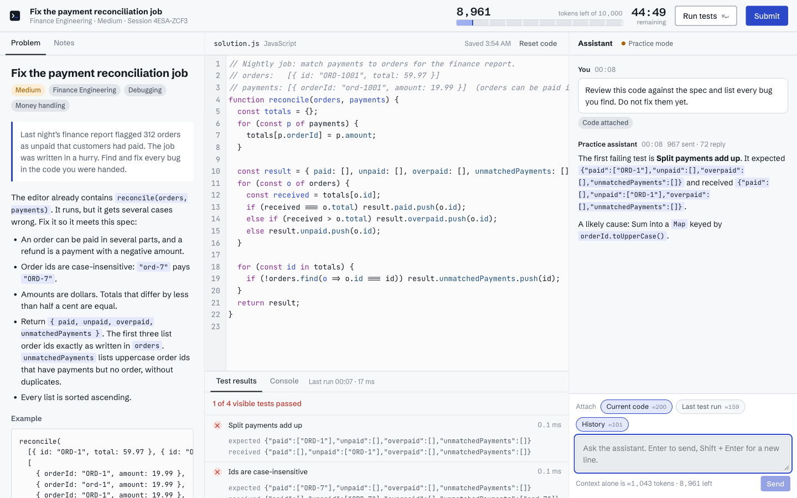
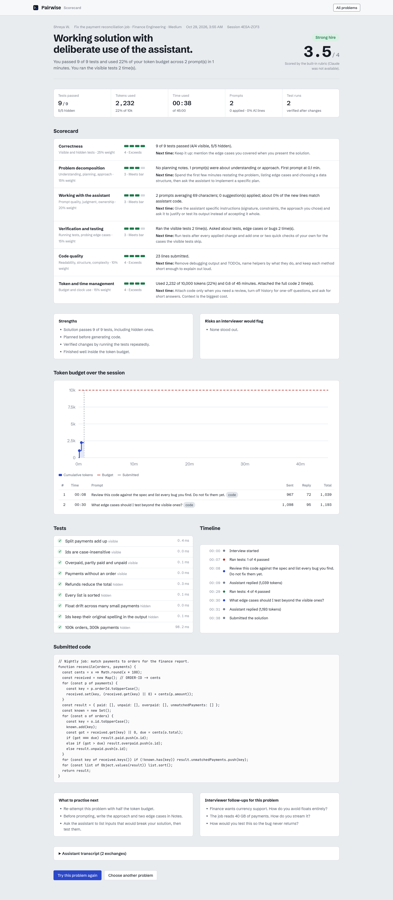
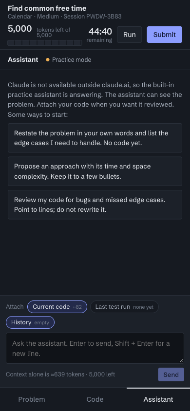
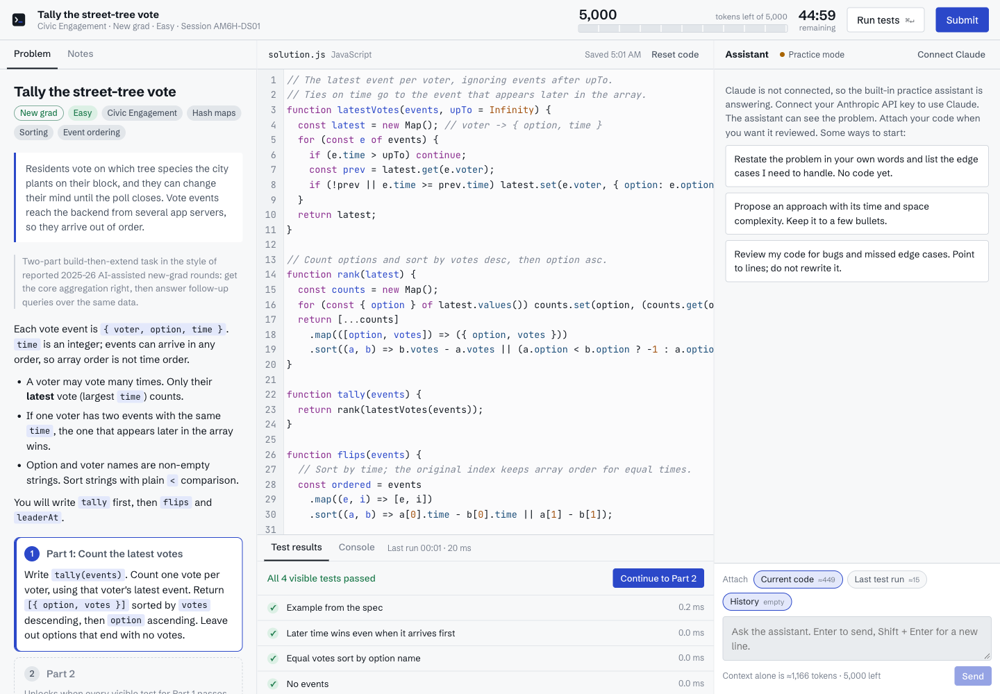
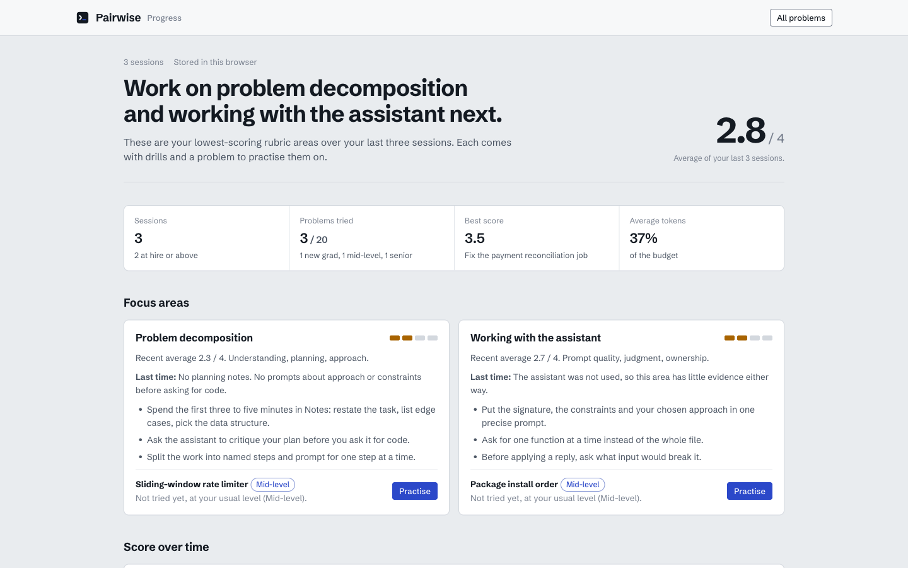

# Pairwise Interview Studio

Practice the AI-assisted coding interview: you get a production-style problem, a coding assistant beside your editor, and a fixed token budget. Every message you send spends tokens. When you submit, hidden tests run and you get a scorecard on the code and on how you worked with the assistant.

**Live:** https://shreya2430.github.io/pairwise-interview-studio/



## What a session looks like

1. **Pick a problem and set the rules.** Twenty problems written as tasks from product teams, tagged New grad, Mid-level or Senior, each with visible and hidden tests. Choose a token budget (5k to 40k), a time limit and the assistant model.
2. **Work with the assistant.** Ask it to plan, write, review or debug. Before you send, the composer shows what the message will cost (instructions, problem, history, attached code, last test run), and you can detach context to save tokens. A reply that would overrun the budget is cut off, and at zero the assistant locks.
3. **Run tests.** Visible tests run in a sandboxed Web Worker with a time limit. Hidden tests, including inputs of 100k to 500k items, run on submit. Multi-part problems reveal Part 2 only once Part 1's visible tests pass, the way staged AI-assisted rounds work.
4. **Read the scorecard.** A hire signal and six weighted rubric areas, each with evidence from your session: correctness, problem decomposition, working with the assistant, verification, code quality, and token and time management. It also shows a token-burn chart, the test results grouped by part, a timeline of prompts, runs, applied suggestions and pastes, review notes on your code, the full transcript and a reference solution.
5. **Debrief and review.** Ask the interviewer follow-up questions about your session on the scorecard. The progress page tracks your score over time, averages each rubric area, flags the habits that cost you points and recommends what to practise next.

| Scorecard | Phone |
| --- | --- |
|  |  |

## Problems

The newer problems are modeled on the formats candidates reported from AI-assisted rounds in 2025 and 2026: a staged bug fix, then a feature, then optimization (Meta); incremental follow-ups on one codebase (Rippling, LinkedIn); requirements that change mid-session (Shopify); and debugging an existing module against failing tests (Amazon, Coinbase). The scenarios, code and tests are original.

| Problem | Level | Difficulty | Parts | Skills |
| --- | --- | --- | --- | --- |
| Find common free time | New grad | Medium | 1 | Intervals, Parsing |
| Slowest endpoints from access logs | New grad | Easy | 1 | Parsing, Aggregation |
| Tally the street-tree vote | New grad | Easy | 2 | Hash maps, Sorting, Event ordering |
| Shuttle loop route distance | New grad | Easy | 2 | Arrays, Prefix sums |
| Greenhouse rover commands | New grad | Medium | 3 | Simulation, Parsing, Extending code |
| Sliding-window rate limiter | Mid-level | Medium | 1 | Data structures, Design |
| Fix the payment reconciliation job | Mid-level | Medium | 1 | Debugging, Money handling |
| Package install order | Mid-level | Medium | 1 | Graphs, Determinism |
| Courier payout tracker | Mid-level | Medium | 3 | Object design, Integer money, Sweep line |
| Feature rollout gate | Mid-level | Medium | 3 | Parsing, Recursion, Exact output |
| Ledger table cursor and pages | Mid-level | Hard | 3 | Debugging, Iterators, Pagination |
| Paginate the merchant orders feed | Mid-level | Medium | 2 | Debugging, API design, Sorting |
| Warehouse query job client | Mid-level | Medium | 2 | State machines, Error handling, Concurrency limits |
| Suggest code reviewers | Mid-level | Medium | 2 | Hash maps, Ranking, Spec reading |
| Onboarding task board | Mid-level | Medium | 3 | Object design, Sorting, Graphs |
| LRU cache with expiry | Senior | Hard | 1 | Data structures, Edge cases |
| Track uploaded byte ranges | Senior | Medium | 3 | Intervals, Binary search, Data structures |
| Pick bin labels with no shared letters | Senior | Hard | 3 | Backtracking, Bitmasks, Pruning |
| Idempotent refund service | Senior | Hard | 2 | Idempotency, Failure handling, API design |
| Route a picking robot through locked aisles | Senior | Hard | 3 | Graph search, State encoding, Debugging |

Every test is checked against a reference solution, and every starter is checked to fail: `node scripts/verify-problems.js`.

| Multi-part problem | Progress review |
| --- | --- |
|  |  |

## Connecting Claude

The assistant and the written assessment run on Claude. There are three ways to use the app:

- **Your own API key (this site).** Click **Connect your API key** and paste an [Anthropic API key](https://console.anthropic.com/settings/keys). Calls go straight from your browser to `api.anthropic.com` with the official SDK, so usage is billed to your Anthropic account. The key is kept in your browser only: in session storage by default, or local storage if you tick **Remember on this device**. Token counts in the gauge use the exact usage the API reports. A Claude.ai Pro or Max subscription cannot be used by other websites; you need an API key.
- **As a claude.ai Artifact.** Published as an Artifact, the page uses the viewer's own Claude account and needs no key.
- **No key.** A built-in practice assistant answers from per-problem hints and a rule-based rubric scores the session. Everything else works the same.

Models with your own key: Fast uses Claude Haiku 5.5, Balanced uses Claude Opus 5.5 at low effort, and Deep uses Claude Opus 5.5 at high effort. Opus requests enable server-side refusal fallbacks (`fallbacks: "default"`).

## Run it locally

No build tools or dependencies are needed to run it.

```sh
git clone git@github.com:shreya2430/pairwise-interview-studio.git
cd pairwise-interview-studio
python3 -m http.server 8000   # then open http://localhost:8000
```

## Project layout

```
index.html                 built page served by GitHub Pages (do not edit by hand)
src/
  body.html                markup for the lobby, workspace, grading and scorecard views
  style.css                design tokens, light and dark themes, responsive layout
  problems.js              the original six problems
  problems/*.js            one file per newer problem (PROBLEMS.push({...}))
  problems-finalize.js     gives every problem the multi-part shape
  app.js                   session state, editor, test runner, assistant, token metering, scoring
  vendor/                  CodeMirror 5 stylesheet
scripts/
  build.sh                 builds index.html and build/artifact.html from src/
  verify-problems.js       checks the schema, runs every test against each reference solution, checks starters fail
docs/screenshots/
```

After editing anything in `src/`, run `./scripts/build.sh` and commit the regenerated `index.html`.

## How scoring works

Correctness comes straight from the tests. The other areas combine session telemetry (planning notes, prompt wording and length, how much code came from the assistant, whether tests were re-run after applying suggestions, token and time use) with Claude's review of the transcript and the final code. Weights: correctness 25%, working with the assistant 20%, decomposition 15%, verification 15%, token and time management 15%, code quality 10%. The verdict is capped by the test pass rate, so a strong process cannot hide a broken solution.

## License

MIT
